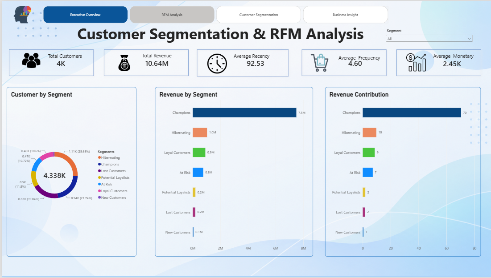
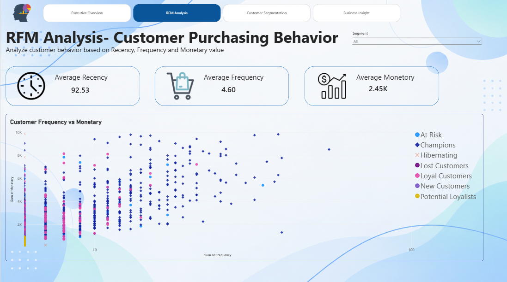
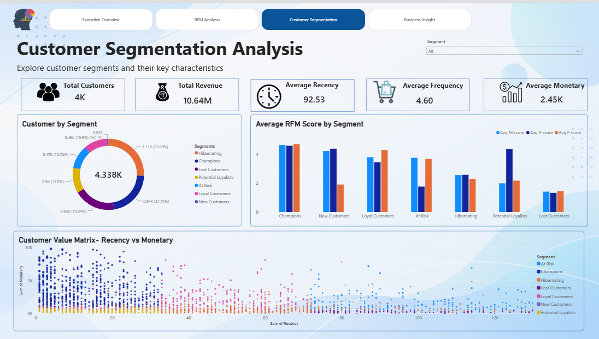
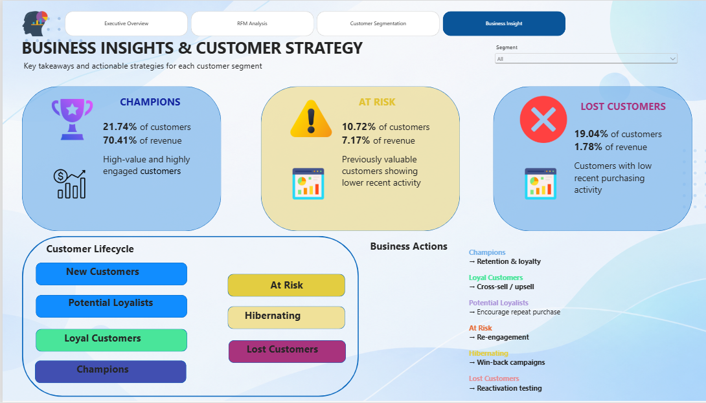

# Customer Segmentation & RFM Analysis with GenAI

> **End-to-end Data Analytics Portfolio Project \| Python + RFM +
> Statistics + Power BI + GenAI**

## 📌 Project Overview

**Customer Segmentation & RFM Analysis with GenAI** is an end-to-end
customer analytics project built to understand purchasing behavior,
identify customer-value segments, quantify revenue concentration, and
translate analytical findings into business actions.

### Project workflow

**Raw Transactions → Data Cleaning → EDA → RFM Analysis → RFM Scoring →
Customer Segmentation → Statistical Analysis → Power BI → GenAI Business
Insights**

### Objectives

-   Clean and validate retail transaction data.
-   Identify valid purchase transactions and separate
    returns/cancellations from the main RFM population.
-   Calculate customer-level **Recency, Frequency, and Monetary (RFM)**
    metrics.
-   Convert RFM metrics into 1--5 scores.
-   Segment customers based on RFM behavior.
-   Analyze customer distribution and revenue contribution.
-   Perform descriptive and correlation analysis.
-   Build an interactive 4-page Power BI dashboard.
-   Use Google Gemini as a GenAI interpretation layer over validated
    segment-level metrics.

------------------------------------------------------------------------

## 🧰 Tech Stack

  Area                  Tools
  --------------------- ----------------------------------------------
  Programming           Python
  Data Analysis         Pandas, NumPy
  Visualization / EDA   Matplotlib, Seaborn
  Customer Analytics    RFM Analysis
  Statistics            Descriptive Statistics, Correlation Analysis
  Dashboarding          Microsoft Power BI
  GenAI                 Google Gemini API
  Notebook              Jupyter Notebook
  Data                  Online Retail Transactions Dataset

------------------------------------------------------------------------

# 📊 Dataset

The project uses the **Online Retail Transactions Dataset**, containing
transaction-level retail purchase information.

### Main columns

  Column          Description
  --------------- ----------------------------------
  `InvoiceNo`     Invoice / transaction identifier
  `StockCode`     Product identifier
  `Description`   Product description
  `Quantity`      Number of units purchased
  `InvoiceDate`   Transaction date and time
  `UnitPrice`     Price per unit
  `CustomerID`    Customer identifier
  `Country`       Customer country

A transaction-level revenue field was created:

``` python
rfm_data['Revenue'] = rfm_data['Quantity'] * rfm_data['UnitPrice']
```

------------------------------------------------------------------------

# 🔍 1. Data Loading & Initial Audit

The dataset was loaded into Pandas and inspected for:

-   dataset dimensions,
-   column names,
-   data types,
-   missing values,
-   duplicate records,
-   negative quantities,
-   non-positive prices,
-   cancellation invoices.

Typical checks:

``` python
df.head()
df.shape
df.info()
df.describe()
df.isnull().sum()
```

------------------------------------------------------------------------

# 🧹 2. Data Cleaning

## Duplicate removal

Exact duplicate records were identified and removed:

``` python
df_clean = df.copy()
df_clean = df_clean.drop_duplicates()
df_clean.duplicated().sum()
```

## Date conversion

`InvoiceDate` was converted to datetime:

``` python
df_clean['InvoiceDate'] = pd.to_datetime(
    df_clean['InvoiceDate']
)
```

## Cancellation detection

Cancellation invoices were identified using the `C` prefix:

``` python
df_clean['InvoiceNo'].astype(str).str.startswith('C')
```

## Negative quantities

Returns/adjustments were investigated through:

``` python
df_clean['Quantity'] <= 0
```

## Non-positive prices

Invalid/non-positive price records were investigated through:

``` python
df_clean['UnitPrice'] <= 0
```

These checks were important because RFM analysis should be based on a
consistent definition of valid purchases.

------------------------------------------------------------------------

# 🧾 3. Valid RFM Transaction Dataset

The main RFM population was created using valid positive purchase
transactions:

``` python
rfm_data = df_clean[
    (~df_clean['InvoiceNo'].astype(str).str.startswith('C')) &
    (df_clean['Quantity'] > 0) &
    (df_clean['UnitPrice'] > 0) &
    (df_clean['CustomerID'].notna())
].copy()
```

Revenue was calculated as:

``` python
rfm_data['Revenue'] = (
    rfm_data['Quantity'] *
    rfm_data['UnitPrice']
)
```

This means the main RFM model uses transactions that:

-   are not cancellation invoices,
-   have positive quantity,
-   have positive unit price,
-   have a valid customer ID.

Returns/cancellations were **identified and investigated**, rather than
silently ignored.

------------------------------------------------------------------------

# 📅 4. Analysis Date

The analysis reference date was defined as one day after the latest
valid transaction:

``` python
analysis_date = (
    rfm_data['InvoiceDate'].max()
    + pd.Timedelta(days=1)
)
```

This gives a consistent reference point for calculating customer
recency.

------------------------------------------------------------------------

# 📈 5. RFM Calculation

## Recency

**How recently did the customer purchase?**

Lower recency days are better because the customer purchased more
recently.

## Frequency

**How often did the customer purchase?**

Higher frequency indicates more repeat purchasing.

## Monetary

**How much revenue did the customer generate?**

Higher monetary value indicates greater customer value within the
analyzed dataset.

### Customer-level aggregation

``` python
rfm = rfm_data.groupby('CustomerID').agg({
    'InvoiceDate': lambda x: (
        analysis_date - x.max()
    ).days,
    'InvoiceNo': 'nunique',
    'Revenue': 'sum'
}).reset_index()
```

Columns were renamed:

``` python
rfm.rename(columns={
    'InvoiceDate': 'Recency',
    'InvoiceNo': 'Frequency',
    'Revenue': 'Monetary'
}, inplace=True)
```

------------------------------------------------------------------------

# 🏷️ 6. RFM Scoring

Each RFM component was converted into a 1--5 score.

Because **lower Recency is better**, Recency scoring is reversed:

``` python
rfm['R_Score'] = pd.qcut(
    rfm['Recency'].rank(method='first'),
    5,
    labels=[5, 4, 3, 2, 1]
).astype(int)
```

Frequency and Monetary use the normal direction:

``` python
rfm['F_Score'] = pd.qcut(
    rfm['Frequency'].rank(method='first'),
    5,
    labels=[1, 2, 3, 4, 5]
).astype(int)

rfm['M_Score'] = pd.qcut(
    rfm['Monetary'].rank(method='first'),
    5,
    labels=[1, 2, 3, 4, 5]
).astype(int)
```

### Combined score

``` python
rfm['RFM_Score'] = (
    rfm['R_Score'] +
    rfm['F_Score'] +
    rfm['M_Score']
)
```

### RFM code

``` python
rfm['RFM_Code'] = (
    rfm['R_Score'].astype(str) +
    rfm['F_Score'].astype(str) +
    rfm['M_Score'].astype(str)
)
```

`rank(method='first')` was used before `qcut` to handle tied values
consistently when creating quantile-based scores.

------------------------------------------------------------------------

# 👥 7. Customer Segmentation

Customers were grouped into business-oriented RFM segments:

-   **Champions**
-   **Loyal Customers**
-   **Potential Loyalists**
-   **New Customers**
-   **At Risk**
-   **Hibernating**
-   **Lost Customers**

The segmentation uses combinations of R, F, and M scores.

Example implementation:

``` python
def segment_customer(row):
    r = row['R_Score']
    f = row['F_Score']
    m = row['M_Score']

    if r >= 4 and f >= 4 and m >= 4:
        return 'Champions'

    elif r <= 2 and f >= 3 and m >= 3:
        return 'At Risk'

    elif r >= 3 and f >= 3 and m >= 3:
        return 'Loyal Customers'

    elif r >= 4 and f <= 3:
        return 'Potential Loyalists'

    elif r >= 4 and f <= 2:
        return 'New Customers'

    elif r <= 2 and f <= 2 and m <= 2:
        return 'Lost Customers'

    else:
        return 'Hibernating'
```

> The segment labels are analytical rules for this project. They
> describe the current RFM snapshot; they do not prove that customers
> historically moved between these stages.

------------------------------------------------------------------------

# 📊 8. Statistical & Business Analysis

## Median RFM values

  Metric          Median
  ----------- ----------
  Recency        51 days
  Frequency     2 orders
  Monetary       670.135

## Correlation analysis

  Relationship              Correlation
  ----------------------- -------------
  Recency vs Frequency           -0.100
  Recency vs Monetary            -0.052
  Frequency vs Monetary       **0.952**

The strongest observed relationship is between **Frequency and
Monetary**, indicating a strong association in this dataset. Correlation
does not establish causation.

------------------------------------------------------------------------

# 📋 9. Segment Summary

The project created a segment-level summary containing:

-   customer count,
-   total revenue,
-   average Recency,
-   average Frequency,
-   average Monetary,
-   average R score,
-   average F score,
-   average M score,
-   customer percentage,
-   revenue percentage.

``` python
segment_summary = rfm.groupby('Segment').agg(
    Customers=('CustomerID', 'count'),
    Total_Revenue=('Monetary', 'sum'),
    Avg_Recency=('Recency', 'mean'),
    Avg_Frequency=('Frequency', 'mean'),
    Avg_Monetary=('Monetary', 'mean'),
    Avg_R_Score=('R_Score', 'mean'),
    Avg_F_Score=('F_Score', 'mean'),
    Avg_M_Score=('M_Score', 'mean')
).reset_index()
```

Customer and revenue contribution:

``` python
total_customers = rfm['CustomerID'].nunique()
total_revenue = rfm['Monetary'].sum()

segment_summary['Customer_%'] = (
    segment_summary['Customers']
    / total_customers * 100
)

segment_summary['Revenue_%'] = (
    segment_summary['Total_Revenue']
    / total_revenue * 100
)
```

------------------------------------------------------------------------

# 💡 10. Key Findings

  ---------------------------------------------------------------------------------
  Segment         Customers Customer %  Revenue %        Avg         Avg        Avg
                                                     Recency   Frequency   Monetary
  ------------- ----------- ---------- ---------- ---------- ----------- ----------
  Champions             943     21.74%     70.41%      12.49       12.70   7,946.28

  At Risk               465     10.72%      7.17%     139.82        3.82   1,641.40

  Hibernating         1,114     25.68%      9.75%      98.76        1.83     931.11

  Lost                  826     19.04%      1.78%     227.39        1.04     228.79
  Customers                                                              

  Loyal                 460     10.60%      8.56%      38.45        5.29   1,979.91
  Customers                                                              

  Potential             499     11.50%      1.83%      17.14        1.65     389.22
  Loyalists                                                              

  New Customers          31      0.71%      0.51%      17.10        1.71   1,751.95
  ---------------------------------------------------------------------------------

### Key analytical observations

-   **Champions** represent 21.74% of customers and 70.41% of analyzed
    revenue.
-   **Hibernating** is the largest segment by customer count at 25.68%.
-   **Lost Customers** represent 19.04% of customers but 1.78% of
    revenue.
-   **At Risk** customers represent 10.72% of customers and 7.17% of
    revenue.
-   **Frequency and Monetary** show a strong positive correlation of
    approximately 0.952.

------------------------------------------------------------------------

# 📊 11. Power BI Dashboard

The project contains a **4-page Power BI dashboard** with page
navigation and segment filtering.

## Page 1 --- Executive Overview

Includes:

-   Total Customers
-   Total Revenue
-   Average Recency
-   Average Frequency
-   Average Monetary
-   Customer by Segment
-   Revenue by Segment
-   Revenue Contribution

Main KPI values shown:

-   Total Customers: **4.338K**
-   Total Revenue: **10.64M**
-   Average Recency: **92.53**
-   Average Frequency: **4.60**
-   Average Monetary: **2.45K**

### DAX measures

``` dax
Total Customers =
DISTINCTCOUNT(customer_rfm_final[CustomerID])
```

``` dax
Total Revenue =
SUM(customer_rfm_final[Monetary])
```

``` dax
Average Recency =
AVERAGE(customer_rfm_final[Recency])
```

``` dax
Average Frequency =
AVERAGE(customer_rfm_final[Frequency])
```

``` dax
Average Monetary =
AVERAGE(customer_rfm_final[Monetary])
```

Revenue contribution:

``` dax
Revenue Contribution % =
DIVIDE(
    [Total Revenue],
    CALCULATE(
        [Total Revenue],
        ALL(customer_rfm_final[Segment])
    )
)
```



------------------------------------------------------------------------

# 📈 12. Power BI Page 2 --- RFM Analysis

This page focuses on customer purchasing behavior using the RFM
dimensions.

### KPI cards

-   Average Recency
-   Average Frequency
-   Average Monetary

### Main visual

**Customer Frequency vs Monetary**

The scatter analysis uses:

-   X-axis → Frequency
-   Y-axis → Monetary
-   Legend → Segment
-   Details → CustomerID

This helps visualize the relationship between purchasing frequency and
customer monetary value.



------------------------------------------------------------------------

# 👥 13. Power BI Page 3 --- Customer Segmentation Analysis

This page compares the customer segments.

### Components

-   Segment slicer
-   Total Customers
-   Total Revenue
-   Average Recency
-   Average Frequency
-   Average Monetary
-   Customer by Segment donut chart
-   Average RFM Score by Segment
-   Customer Value Matrix

### Average RFM score measures

``` dax
Avg R Score =
AVERAGE(customer_rfm_final[R_Score])
```

``` dax
Avg F Score =
AVERAGE(customer_rfm_final[F_Score])
```

``` dax
Avg M Score =
AVERAGE(customer_rfm_final[M_Score])
```

The Customer Value Matrix visualizes customer-level Recency and Monetary
behavior with Frequency and Segment as additional dimensions.



------------------------------------------------------------------------

# 💼 14. Power BI Page 4 --- Business Insights & Customer Strategy

This page translates the analytical findings into business-oriented
observations and suggested actions.

### Featured segments

**Champions**

-   21.74% of customers
-   70.41% of revenue
-   High RFM values
-   Suggested focus: retention and loyalty

**At Risk**

-   10.72% of customers
-   7.17% of revenue
-   Higher recency than stronger-engagement groups
-   Suggested focus: re-engagement

**Lost Customers**

-   19.04% of customers
-   1.78% of revenue
-   High recency and low RFM values
-   Suggested focus: controlled reactivation testing

### Conceptual lifecycle

``` text
New Customers
      ↓
Potential Loyalists
      ↓
Loyal Customers
      ↓
Champions
```

Lower-engagement path:

``` text
At Risk
   ↓
Hibernating
   ↓
Lost Customers
```

This is a conceptual framework rather than an observed customer
transition history.



------------------------------------------------------------------------

# 🤖 15. GenAI Integration

A GenAI layer was added after the analytical calculations.

### Division of responsibilities

**Python performs:**

-   data cleaning,
-   RFM calculation,
-   scoring,
-   segmentation,
-   aggregation,
-   percentages,
-   statistical analysis.

**Gemini performs:**

-   concise natural-language explanation,
-   segment-level insight generation,
-   business opportunity/risk interpretation,
-   suggested business actions.

The GenAI model is therefore an **interpretation layer over validated
metrics**, not the source of the underlying calculations.

### GenAI workflow

``` text
RFM Data
   ↓
Segment Summary
   ↓
Convert to JSON
   ↓
Gemini API
   ↓
Structured Insights
   ↓
Pandas DataFrame
   ↓
genai_customer_insights.csv
```

Segment data was converted into JSON-compatible records:

``` python
segment_data = segment_summary.to_dict(
    orient='records'
)
```

The GenAI prompt instructed the model to:

-   use only supplied metrics,
-   avoid unsupported assumptions,
-   identify key behavior,
-   identify opportunities or risks,
-   suggest practical actions,
-   return structured output.

The final structured response was converted to a DataFrame and exported
as:

``` python
genai_insights.to_csv(
    "genai_customer_insights.csv",
    index=False
)
```

------------------------------------------------------------------------

# 📁 16. Final Project Files

Recommended repository structure:

``` text
Customer-Segmentation-RFM/
│
├── images/
│   ├── executive_overview.png
│   ├── rfm_analysis.png
│   ├── customer_segmentation.png
│   └── business_insights.png
│
├── Online Retail.csv
├── RFM_Analysis.ipynb
├── customer_rfm_final.csv
├── genai_customer_insights.csv
├── Customer_Segmentation_RFM.pbix
└── README.md
```

### `customer_rfm_final.csv`

Final customer-level analytical dataset:

``` text
CustomerID
Recency
Frequency
Monetary
R_Score
F_Score
M_Score
RFM_Score
RFM_Code
Segment
```

### `genai_customer_insights.csv`

GenAI interpretation dataset:

``` text
Segment
Key Insight
Customer Behavior
Business Opportunity/Risk
Recommended Actions
```

------------------------------------------------------------------------

# 🎨 17. Dashboard Design

The dashboard uses a clean modern analytics theme with:

-   page navigation,
-   KPI cards,
-   slicers,
-   donut charts,
-   bar charts,
-   clustered column charts,
-   scatter plots,
-   insight cards,
-   lifecycle visualization,
-   business action recommendations.

The design is intended to make the analytical story easy to follow:

**Executive Overview → RFM Analysis → Customer Segmentation → Business
Strategy**

------------------------------------------------------------------------

# ⚠️ 18. Analytical Assumptions & Limitations

### RFM is a snapshot

Recency is calculated relative to the latest valid transaction date in
the dataset. It describes customer behavior at that reference point.

### Monetary is customer-level total value

Monetary represents the sum of valid transaction revenue for the
customer in the analyzed data. It is not the same as average order
value.

### Correlation is not causation

The 0.952 Frequency--Monetary correlation indicates a strong association
in this dataset, but it does not prove that one variable causes the
other.

### Segments are rule-based

The customer segments are created from project-defined RFM score rules.
Different businesses can use different thresholds and segment
definitions.

### Lifecycle arrows are conceptual

The dashboard's lifecycle arrows are a business framework. The dataset
is not a longitudinal experiment proving that customers actually moved
through every stage.

### GenAI is grounded in analytics

Gemini receives aggregated RFM metrics generated by Python. It should
not be treated as the calculator of the underlying metrics.

------------------------------------------------------------------------

# 🚀 19. Business Value

The project demonstrates how a Data Analyst can move from raw
transaction data to a decision-support dashboard.

### Analytical value

-   Identifies customer-value differences.
-   Quantifies revenue concentration.
-   Highlights recent purchasing behavior.
-   Groups customers into actionable segments.
-   Provides a repeatable RFM framework.

### Potential business use cases

-   Customer retention
-   Loyalty programs
-   Re-engagement campaigns
-   Win-back experiments
-   Repeat-purchase initiatives
-   Customer-value prioritization
-   Marketing segmentation

------------------------------------------------------------------------

# 🧑‍💻 20. Skills Demonstrated

### Python & Analytics

-   Python
-   Pandas
-   NumPy
-   Matplotlib
-   Seaborn
-   Data cleaning
-   EDA
-   Feature engineering
-   Aggregation
-   Descriptive statistics
-   Correlation analysis

### Customer Analytics

-   RFM analysis
-   RFM scoring
-   Customer segmentation
-   Revenue contribution
-   Customer lifecycle framework

### Power BI

-   DAX
-   KPI cards
-   Slicers
-   Donut charts
-   Bar charts
-   Clustered column charts
-   Scatter plots
-   Dashboard navigation
-   Business storytelling

### GenAI

-   Gemini API
-   Prompt engineering
-   Metric-grounded insight generation
-   Structured AI output
-   AI-assisted business recommendations

------------------------------------------------------------------------

# 📌 21. Resume-Ready Project Description

**Customer Segmentation & RFM Analysis with GenAI \| Python, Power BI,
Statistics, Gemini API**

-   Analyzed online retail transactions and developed customer-level
    **Recency, Frequency, and Monetary (RFM)** metrics to segment
    **4.3K+ customers** based on purchasing behavior.
-   Built an interactive **4-page Power BI dashboard** covering customer
    distribution, revenue contribution, RFM behavior, segment
    performance, and customer strategy.
-   Identified strong revenue concentration among high-value customers,
    with the Champions segment representing **21.74% of customers and
    70.41% of analyzed revenue**.
-   Performed descriptive and correlation analysis, identifying a
    **0.952 Frequency--Monetary correlation** within the analyzed
    customer population.
-   Integrated **Google Gemini API** to transform validated
    segment-level RFM metrics into structured business insights and
    recommended actions.

------------------------------------------------------------------------

# ⭐ Final Project Summary

This project demonstrates an end-to-end Data Analyst workflow:

> **Clean the data → validate transactions → calculate RFM → score
> customers → segment customers → analyze behavior and revenue → build
> an interactive Power BI dashboard → use GenAI to communicate validated
> business insights.**

The project combines quantitative analysis, dashboard development,
customer analytics, business storytelling, and responsible GenAI usage
in one portfolio project.

------------------------------------------------------------------------

## 👤 Author

**Lokesh Kumar**

**Data Analytics \| Python \| SQL \| Power BI \| Statistics \| GenAI**
